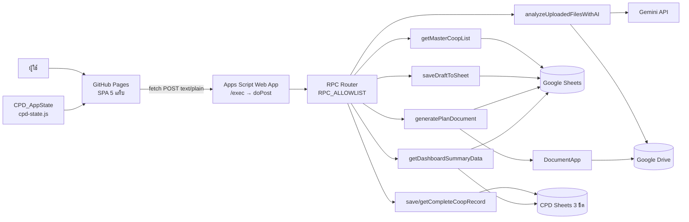

# สถาปัตยกรรม

## 1. สถานะปัจจุบัน (As-Is)

โค้ดเดิมเป็น **container-bound script** ของ Google Sheets:

```
เบราว์เซอร์
  └─ HtmlService (Index.html)
        └─ google.script.run  ─────► Code.gs (รันในนามเจ้าของสคริปต์)
                                        ├─ SpreadsheetApp.getActiveSpreadsheet()
                                        │    ├─ คำสั่งมอบหมาย
                                        │    ├─ ผลปี68
                                        │    ├─ ผลปี69
                                        │    └─ บันทึกข้อมูล (JSON draft)
                                        ├─ UrlFetchApp → Gemini API
                                        ├─ DocumentApp → สร้าง .docx
                                        └─ DriveApp → ลบไฟล์ชั่วคราว
```

ข้อจำกัดที่ทำให้ย้ายไป GitHub Pages ตรง ๆ ไม่ได้:

| ปัญหา | ผลกระทบ |
|---|---|
| `google.script.run` ใช้ได้เฉพาะใน HtmlService | เรียกจาก static site ไม่ได้ |
| ไม่มี `doPost` | ไม่มี HTTP API ให้ frontend เรียก |
| Web App ที่ต้องล็อกอิน Google | `fetch` ข้ามโดเมนจะโดน redirect ไปหน้า login + CORS พัง |
| `GEMINI_API_KEY` เป็น global ที่ไม่ปรากฏในโค้ดที่ส่งมา | ต้องย้ายไป Script Properties |
| `SpreadsheetApp.getActiveSpreadsheet()` | ไม่ชัดเจนว่าได้ spreadsheet ในบริบท web app |

## 2. สถาปัตยกรรมเป้าหมาย (To-Be)



### หลักการสำคัญ

1. **GitHub เป็น source of truth** — ทั้ง frontend และ backend อยู่ใน repo เดียว
2. **Apps Script เป็น API อย่างเดียว** — ไม่ serve HTML อีกต่อไป (เก็บ `doGet` เดิมไว้เป็น legacy ได้)
3. **frontend เดิมไม่ต้องเขียนใหม่** — ใช้ shim แปลง `google.script.run` เป็น `fetch`
4. **การ deploy แยกสองทาง แต่ trigger จาก repo เดียว** — Pages กับ clasp

## 3. หน้าที่ของแต่ละองค์ประกอบ

| องค์ประกอบ | ไฟล์ | หน้าที่ |
|---|---|---|
| Static UI | `web/index.html` | ฟอร์มเดิม Tab 1 + shell เมนู 5 แท็บ |
| UI แท็บ 2–5 | `web/js/cpd-ui.js` | แผนเต็ม, รายเดือน, ปิดบัญชี, Dashboard, ส่งออก |
| State กลาง | `web/js/cpd-state.js` | sync, merge, auto-calc, โหลด state กลับฟอร์ม |
| SPA style | `web/css/cpd.css` | เมนู, ตาราง, การ์ด, สถานะสีและ Print |
| Runtime config | `web/config.js` | `API_URL`, `API_TOKEN` |
| RPC shim | `web/js/google-script-shim.js` | แปลง `google.script.run` → `fetch` |
| HTTP entry | `gas/Api.gs` | `doPost`, allowlist, JSON envelope, token |
| Config | `gas/config.gs` | อ่าน Script Properties, `getSS_()` |
| Business logic เดิม | `gas/Code.gs` | คำนวณคะแนน, AI, สร้าง Word |
| CPD database | `gas/CPD_Database.gs` | upsert state, โหลดแผน, สรุป Dashboard จาก 3 ชีต |
| Sheets helper | `gas/lib/SheetUtil.gs` | อ่านตาราง, lock, กัน formula injection |
| Drive helper | `gas/lib/DriveUtil.gs` | สร้างโฟลเดอร์, เก็บไฟล์ |
| CI frontend | `.github/workflows/pages.yml` | deploy `web/` |
| CI backend | `.github/workflows/gas-deploy.yml` | `clasp push` + `clasp deploy` |

## 4. ลำดับการทำงานของแต่ละคำขอ

### 4.1 โหลดรายชื่อสหกรณ์

```
onload → google.script.run.getMasterCoopList()
  → shim POST {action:'rpc', fn:'getMasterCoopList', args:[]}
  → doPost → allowlist → getMasterCoopList()
  → อ่าน 4 ชีต → คำนวณ simResult → คืน array
```

### 4.2 วิเคราะห์เอกสาร

```
ไฟล์ → smartProcessFile() ฝั่ง browser (PDF.js / pdf-lib)
  → payload {files:[{extractedText|base64}], ...}
  → doPost → analyzeUploadedFilesWithAI(payload)
  → Gemini (ลองหลายโมเดล) → JSON → คืนให้ฟอร์ม
```

### 4.3 สร้าง Word

```
collectFormObject()
  → doPost → generatePlanDocument(form)
  → saveDraftToSheet(form)
  → DocumentApp สร้างเอกสาร → export .docx → base64
  → คืน {fileName, fileData, mimeType}
  → browser สร้าง Blob แล้วดาวน์โหลด
```

### 4.4 บันทึกและโหลดแผนทั้ง 5 แท็บ

```
เลือกสหกรณ์/AI/กรอกแท็บ 2–4
  → cpd-state.js รวมเป็น CPD_AppState ชุดเดียว
  → saveCompleteCoopRecord({state, form})
  → Script Lock → upsert CPD_Plans_2570 + Monthly_Tracking + Closing_Success
  → full_state_json เก็บ state สำหรับ round-trip
เลือกสหกรณ์หรือกด "โหลดข้อมูลเพื่อแก้ไข"
  → getCompleteCoopRecord → loadStateFromRecord → เติม Tab 1–4 และคำนวณซ้ำ
```

### 4.5 Dashboard

```
getDashboardSummaryData(filters)
  → อ่าน master list + CPD Sheets 3 ชีต
  → join ด้วย fiscalYear + coopId (fallback ชื่อ)
  → กรอง → KPI/zone/class/dimension/rows → cpd-ui.js วาด CSS charts
  → ถ้า RPC ล้มเหลว ใช้ masterCoops + state ปัจจุบันเป็นข้อมูลสำรองพร้อม badge แจ้งเตือน
```

## 5. ทำไมใช้ shim ไม่เขียน frontend ใหม่

- โค้ด UI ประมาณ 700 บรรทัดทำงานได้ทันที ลดความเสี่ยง Regression
- ระหว่างย้าย สามารถเปิดทั้ง HtmlService และ Pages พร้อมกันเพื่อเทียบผล
- เมื่อพร้อมค่อย ๆ แตก `app.js` เป็นโมดูลและเปลี่ยนไปใช้ `api.js` ตรง ๆ

ข้อจำกัดของ shim: ค่าที่ส่งต้องเป็น JSON, ไม่รองรับ `google.script.host`/`history`/`url`
(โค้ดปัจจุบันไม่ได้ใช้)

## 6. Security model

```
ผู้ใช้ → Pages (public)
        → doPost
            ├─ ตรวจ API_TOKEN (ถ้าตั้ง)
            ├─ ตรวจชื่อฟังก์ชันใน allowlist
            └─ ทำงานในนามเจ้าของสคริปต์ (executeAs: USER_DEPLOYING)
```

- `API_TOKEN` เป็นเพียง **speed bump** เพราะอยู่ในไฟล์ public
- ถ้าต้องการยืนยันตัวตนจริง → Google Sign-In + ตรวจ ID token (ระยะที่ 3)
- ทุกฟังก์ชันที่เปิดให้เรียกต้องอยู่ใน `RPC_ALLOWLIST` เท่านั้น
- ไม่ส่ง stack trace กลับ ยกเว้นตั้ง `DEBUG=1`

## 7. ข้อจำกัดของแพลตฟอร์ม

| หัวข้อ | ขีดจำกัด |
|---|---|
| Apps Script execution | 6 นาที/ครั้ง |
| Apps Script quota (consumer) | ~90 นาที/วัน |
| `UrlFetchApp` | 20,000 ครั้ง/วัน |
| POST body | ~50 MB |
| Sheets | 10 ล้านเซลล์/ไฟล์ |
| Drive | 15 GB (รวม Gmail) |
| GitHub Pages private repo | ต้องมี Pro/Team |
