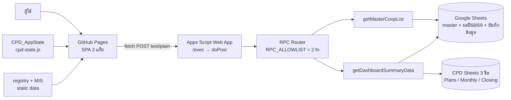

# สถาปัตยกรรม (3-tab tracking app)

## 1. ภาพรวม

แอปเป็น SPA แบบ **read-only** — อ่านข้อมูลจาก Google Sheets ผ่าน Apps Script Web App
และแสดงผล 3 หน้า ไม่มีการเขียน Sheets ไม่มี AI ไม่มีอัปโหลดไฟล์ และไม่ใช้ Google Drive

```
ผู้ใช้ → GitHub Pages (web/index.html)
          ├─ cpd-state.js   (state, deadlines, recalcStrength)
          ├─ cpd-ui.js      (dashboard / registry / strength)
          ├─ cpd-report-registry.js
          └─ cpd-mis-reports.js
       → fetch POST text/plain (google-script-shim.js)
       → Apps Script /exec → doPost → RPC_ALLOWLIST
       → getMasterCoopList / getDashboardSummaryData
       → Google Sheets (master/KPI/score)
```

## 2. แผนภาพ



### หลักการสำคัญ

1. **GitHub เป็น source of truth** — ทั้ง frontend และ backend อยู่ใน repo เดียว
2. **Apps Script เป็น API อย่างเดียว** — `doGet` คงไว้แค่ไม่ให้ `/exec` ขึ้น error
3. **frontend เรียกชื่อเดิมได้** — shim แปลง `google.script.run` เป็น `fetch`
4. **read-only เท่านั้น** — ไม่มี endpoint ที่เขียนข้อมูลอีกต่อไป
5. **deploy แยกสองทาง** — Pages กับ clasp แต่จาก repo เดียว

## 3. หน้าที่ของแต่ละองค์ประกอบ

| องค์ประกอบ | ไฟล์ | หน้าที่ |
|---|---|---|
| Static UI | `web/index.html` | shell 3 แท็บ + loader `loadMasterCoops()` |
| UI 3 หน้า | `web/js/cpd-ui.js` | dashboard, registry, strength, early-warning, export |
| State กลาง | `web/js/cpd-state.js` | state shape, fiscal deadlines, recalcStrength |
| Registry data | `web/js/cpd-report-registry.js` | รายการเอกสาร/รายงาน 43 รายการ |
| MIS data | `web/js/cpd-mis-reports.js` | รายงาน MIS |
| SPA style | `web/css/cpd.css` | เมนู, ตาราง, การ์ด, สถานะสีและ Print |
| Runtime config | `web/config.js` | `API_URL`, `API_TOKEN` |
| RPC shim | `web/js/google-script-shim.js` | แปลง `google.script.run` → `fetch` (timeout 30 วิ) |
| HTTP entry | `gas/Api.gs` | `doPost`, allowlist 2 ตัว, token, redaction |
| Config | `gas/config.gs` | อ่าน Script Properties, `getSS_()` |
| Master list | `gas/Code.gs` | `getMasterCoopList`, กฎจัดชั้นความเข้มแข็ง |
| Strength fallback | `gas/GroupStrength69.gs` | คะแนนกลุ่มเกษตรกร ปี 2569 |
| Dashboard read | `gas/CPD_Database.gs` | `getDashboardSummaryData`, `clearPlanAiData_()` (editor-only) |
| Setup helper | `gas/Setup.gs` | ตรวจ properties + การเชื่อม Sheets |
| CI frontend | `.github/workflows/pages.yml` | deploy `web/` |
| CI backend | `.github/workflows/gas-deploy.yml` | `clasp push` + `clasp deploy` |

## 4. ลำดับการทำงานของแต่ละคำขอ

### 4.1 โหลดรายชื่อสหกรณ์ (ใช้ร่วม dashboard และ strength)

```
onload → google.script.run.getMasterCoopList()
  → shim POST {action:'rpc', fn:'getMasterCoopList', args:[]}
  → doPost → allowlist → getMasterCoopList()
  → อ่าน คำสั่งมอบหมาย / ผลปี68 / ผลปี69 / บันทึกข้อมูล
  → คำนวณ simResult + จัดชั้น → คืน array ใส่ global masterCoops
```

หมายเหตุ: กลุ่มเกษตรกรที่ชีต `ผลปี69` ยังไม่มีคะแนน จะถูกเติมจาก `gas/GroupStrength69.gs`
(ข้อมูลจากชีตจริงชนะเสมอ) — ดูรายละเอียดใน `docs/data-model.md`

### 4.2 Dashboard

```
switchTab('dashboard') → loadDashboard(filters)
  → google.script.run.getDashboardSummaryData(filters)
  → doPost → allowlist → getDashboardSummaryData()
  → อ่าน master + CPD 3 ชีต → join → กรอง → KPI/zone/class/dimension/rows
  → cpd-ui.js วาดการ์ด/กราฟ CSS + ตาราง + ส่งออก CSV/Excel
  → ถ้า RPC ล้มเหลว ใช้ fallbackDashboard() (masterCoops + CPD_AppState) พร้อม badge
```

### 4.3 Registry

```
switchTab('registry') → renderReportRegistry() + renderMisReports()
  → อ่าน cpd-report-registry.js (43 รายการ) และ cpd-mis-reports.js
  → กรอง/ค้นหา/ขยายรายการฝั่ง client — ไม่เรียก API
```

### 4.4 Strength

```
switchTab('strength') → renderStrengthRows()
  → อ่าน CPD_AppState.strength.indicators (18 ตัวชี้วัด × 3 ปี)
  → เติมค่าปี 2569 จาก masterCoops[].score69.subScores ถ้ามี
  → recalcStrength() คำนวณคะแนน/จัดชั้นถ้าจำเป็น
```

### 4.5 ล้างข้อมูลแผน/AI (editor-only, ครั้งเดียว)

```
Apps Script editor → Run clearPlanAiData_()
  → ล้างเฉพาะ full_state_json / monthly_json / closing_json
    และคอลัมน์ H ของ บันทึกข้อมูล
  → ไม่ลบ master/KPI/score และไม่ลบชีตใด ๆ
```

## 5. ทำไมใช้ shim

- frontend เรียกชื่อฟังก์ชันเดิมได้ (`google.script.run.*`) โดยไม่ต้องเขียนโค้ดเรียก API ใหม่
- shim ใช้ `Content-Type: text/plain` เพื่อเลี่ยง CORS preflight (Apps Script ไม่รับ `OPTIONS`)
- `fetch` มี timeout 30 วินาที (ไม่มี AI job ที่ต้องใช้เวลานานแล้ว)

ข้อจำกัดของ shim: ค่าที่ส่งต้องเป็น JSON, ไม่รองรับ `google.script.host`/`history`/`url`
(โค้ดปัจจุบันไม่ได้ใช้)

## 6. Security model

```
ผู้ใช้ → Pages (public)
        → doPost
            ├─ ตรวจขนาด body (≤ 64 KB)
            ├─ ตรวจ API_TOKEN (ถ้าตั้ง)
            ├─ ตรวจชื่อฟังก์ชันใน allowlist (2 ตัว)
            └─ redactSecrets_() ก่อนคืน error
            └─ ทำงานในนามเจ้าของสคริปต์ (executeAs: USER_DEPLOYING)
```

- `API_TOKEN` เป็นเพียง **speed bump** เพราะอยู่ในไฟล์ public
- ถ้าต้องการยืนยันตัวตนจริง → Google Sign-In + ตรวจ ID token ใน `doPost`
- ทุกฟังก์ชันที่เปิดให้เรียกต้องอยู่ใน `RPC_ALLOWLIST` เท่านั้น
- ไม่ส่ง stack trace กลับ ยกเว้นตั้ง `DEBUG=1` (และยังผ่าน redaction)

## 7. ข้อจำกัดของแพลตฟอร์ม

| หัวข้อ | ขีดจำกัด |
|---|---|
| Apps Script execution | 6 นาที/ครั้ง |
| Apps Script quota (consumer) | ~90 นาที/วัน |
| POST body (Api.gs) | 64 KB (กำหนดเอง) |
| Sheets | 10 ล้านเซลล์/ไฟล์ |
| GitHub Pages private repo | ต้องมี Pro/Team |

## 8. ระบบที่ถูกลบ (historical)

ฟังก์ชัน/ไฟล์เหล่านี้ถูกลบจริงตามคำขอ — **ห้ามเพิ่มกลับโดยไม่ได้รับอนุมัติ**:

- หน้า: ฟอร์มพื้นฐาน, แผนฉบับเต็ม, ติดตามรายเดือน, รายงานปิดบัญชี (คงเฉพาะ dashboard/registry/strength)
- JS: `cpd-upload.js`, `cpd-preload.js`, `cpd-4m-engine.js`, `cpd-business-analysis.js`, `cpd-pdf-pipeline.js`
- GAS: `AiJob.gs`, `lib/DriveUtil.gs`, `lib/SheetUtil.gs`, ฟังก์ชัน AI/plan/Word ใน `Code.gs`
- API: `saveDraftToSheet`, `analyzeUploadedFilesWithAI`, `startAiAnalysisJob`, `stepAiAnalysisJob`,
  `generatePlanDocument`, `saveCompleteCoopRecord`, `getCompleteCoopRecord`
- หน้า `web/analyzer/` (PDF.js/XLSX analyzer ที่แยกจาก SPA)

ดูบันทึกเดิมได้ใน `docs/migration.md`, `docs/upload-data-flow.md`, `docs/upload-quality-upgrade.md`
( historical archive — ไม่ใช่คู่มือระบบปัจจุบัน)
