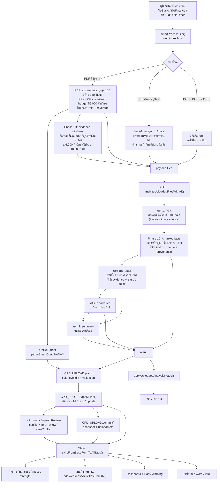

# เส้นทางข้อมูลหลังอัปโหลดไฟล์ (Upload Data Flow)

เอกสารนี้อธิบายว่าไฟล์ที่ผู้ใช้อัปโหลดถูกอ่านด้วยวิธีใด ถูกส่งไปให้ AI สกัดเป็นฟิลด์อะไร
และข้อมูลแต่ละฟิลด์ถูกนำไปใช้ในหน้าจอ/State/เอกสารส่วนใด

> หลักสำคัญ: **หมวดไฟล์ (ข้อมูลพื้นฐาน / งบการเงิน / ผลปิดบัญชี / ไฟล์อื่น ๆ) เป็นเพียงป้ายบอกบริบท**
> เนื้อหาทุกไฟล์ที่สกัดได้จะถูกส่งให้ AI ทั้งหมด AI จึงอาจดึงตัวเลขงบการเงินจากไฟล์ที่อยู่ในช่อง "ไฟล์อื่น ๆ" ได้
> ตาราง "แหล่งข้อมูลหลัก" ด้านล่างจึงหมายถึงแหล่งที่ปกติควรพบข้อมูลนั้น ไม่ใช่การบังคับ

---

## 1. ภาพรวมเส้นทางข้อมูล

### ตัวอย่างการตามรอยหนึ่งฟิลด์

`assetLatest` (ยอดสินทรัพย์รวม):

1. อ่านจากงบฐานะการเงินใน PDF → `extractedText`
2. GAS ระยะ 1 คืน `res.assetLatest`
3. `CPD_UPLOAD.plan()` ตัดสินสถานะของ `#asset_latest` (ว่าง → `fill`, มีค่าเดิม → `conflict`/`same`/`update`)
4. `CPD_UPLOAD.applyPlan()` เติมเฉพาะสถานะที่ปลอดภัย แล้ว `commit()` เก็บ snapshot
5. `syncFromBaseFormToAllTabs()` → `AppState.financials.summary2Years.assetsLatest`
6. `recalcFinancials()` คำนวณ `balanceSheet.totalAssets` และอัตราส่วน
7. Dashboard / Early Warning / ข้อ 1 (4M) / เอกสาร Word ใช้ค่าที่คำนวณแล้ว

---

## 2. วิธีอ่านไฟล์แต่ละชนิด

| ช่องอัปโหลด | `category` ที่ส่งไป GAS | วิธีอ่าน | เงื่อนไข/ข้อจำกัด |
| --- | --- | --- | --- |
| `fileBasic` | ข้อมูลพื้นฐาน | PDF.js / DOCX / XLSX / base64 | PDF สแกนแบ่งชุดละ 12 หน้าตามงบที่แบ่งให้ |
| `fileFinance` | งบการเงิน/รายงานสอบบัญชี | PDF.js / DOCX / XLSX / base64 | PDF สแกนแบ่งชุดละ 12 หน้าตามงบที่แบ่งให้ |
| `fileAudit` | ผลปิดบัญชี/ข้อสังเกต | PDF.js / DOCX / XLSX / base64 | PDF สแกนแบ่งชุดละ 12 หน้าตามงบที่แบ่งให้ |
| `fileOther` | ไฟล์อื่น ๆ | PDF.js / DOCX / XLSX / base64 | PDF สแกนแบ่งชุดละ 12 หน้าตามงบที่แบ่งให้ |

### PDF ที่มีข้อความ (Phase 1A)

- อ่านข้อความ **ทุกหน้า** สูงสุด 150 หน้า หรือจนครบเวลาอ่าน ~150 วินาที (`READ_TOTAL_BUDGET_MS`) (ไม่จำกัด 25 หน้าแรกเหมือนเดิม)
- ให้คะแนนแต่ละหน้าด้วย `CPD_UPLOAD.scorePageText()`
  - หัวข้อการเงิน (`งบฐานะการเงิน`, `งบดุล`, `งบกำไรขาดทุน`, `งบกระแสเงินสด`, `รวมสินทรัพย์`, `ทุนเรือนหุ้น`, `ทุนสำรอง`) → +3 ต่อคำ (สูงสุด 9)
  - คำสำคัญทั่วไป (`สินทรัพย์`, `หนี้สิน`, `รายได้`, `ผู้สอบบัญชี`, `สมาชิก`, …) → +1 ต่อคำ (สูงสุด 5)
  - ความหนาแน่นของตัวเลข → สูงสุด +6, ลักษณะตารางตัวเลข → +3
  - หน้า 1–3 (ข้อมูลพื้นฐาน/ใบโปรไฟล์) → +2 และ **ถูกเลือกเสมอ**
- `CPD_UPLOAD.selectPages()` เลือกหน้าคะแนนสูงจนเต็ม budget ต่อไฟล์ 55,000 ตัวอักษร แล้วเรียงกลับตามเลขหน้า
- **ไม่ตัดกลางหน้า** — ข้อความที่ส่งเข้า AI ถูกตัดที่ขอบหน้าเสมอ และแต่ละหน้าถูกทำเครื่องหมาย `[หน้า N]`
- จำกัดตัวอักษรรวมทุกไฟล์ 180,000 ตัวอักษร (`CPD_UPLOAD.applyTotalBudget()`, ขั้นต่ำ 12,000 ตัวอักษร/ไฟล์) โดยตัดไฟล์ที่ใหญ่ที่สุดก่อน
- **Phase 1B — evidence windows:** หน้าที่ไม่ได้ถูกส่งทั้งหน้า (ถูกข้ามตอนเลือก หรือถูกตัดเพราะ budget) จะถูกเก็บข้อความสั้น ๆ รอบคำสำคัญ เช่น `รวมสินทรัพย์`, `ทุนสำรอง`, `กำไรสุทธิ`, `ผู้สอบบัญชี`, `ข้อสังเกต`
  - `CPD_UPLOAD.extractEvidence()` เก็บไม่เกิน 2 ช่วง/หน้า, 6,000 ตัวอักษร/ไฟล์
  - `CPD_UPLOAD.applyTotalBudget()` จำกัด evidence รวมทุกไฟล์ไม่เกิน 18,000 ตัวอักษร
  - หลักฐานถูกส่งเฉพาะระยะ `facts` (ไม่ส่งซ้ำในระยะ `narrative`/`summary`)
- **Phase 1C — chunked facts:** ถ้าข้อความรวมทุกไฟล์เกิน `AI_CHUNK_THRESHOLD_CHARS` (90,000) GAS จะแบ่งเป็นช่วงหน้าละ ≤ ~`AI_CHUNK_TARGET_CHARS` (45,000) ตัวอักษร โดยแต่ละช่วงอยู่ภายในไฟล์เดียวและไม่ตัดกลางหน้า แล้วสกัด `facts` ทีละช่วงก่อน merge (ไม่ต้องอัปโหลดใหม่หรือแบ่งไฟล์เอง)
- แสดงการ์ด `#uploadCoverage` บอกว่าอ่านกี่หน้า / ส่งเข้า AI กี่หน้า / ข้ามหน้าใด พร้อมเตือนหน้าที่มีแนวโน้มสำคัญแต่ยังไม่ได้ส่ง
- แสดงบรรทัด "🔎 หลักฐานเสริมจากหน้า … • n ช่วง • n ตัวอักษร" เมื่อมี evidence
- ถ้าข้อความรวมมากกว่า 250 ตัวอักษร → ใช้ `extractedText` (ไม่ส่งไฟล์ PDF ทั้งก้อน)
- พร้อมกันนั้นเรียก `parseSmartCoopProfile()` กับข้อความจากทุกหน้าที่อ่านได้ (สูงสุด 120,000 ตัวอักษร) เพื่อดึงข้อมูลใบโปรไฟล์ด้วย regex

### PDF สแกน / รูปภาพ

- ถ้าสกัดข้อความได้น้อย → ใช้ `pdf-lib` แบ่งเป็นชุดละ 12 หน้า แล้วส่งเป็น `base64` (`inlineData`)
- งบ `base64` รวมทุกไฟล์อยู่ที่ 18MB และถูกแบ่งตามจำนวนไฟล์ที่เลือก (ไม่ใช่ 18MB ต่อไฟล์)
- ถ้าชุดใดใหญ่เกินงบที่เหลือ ระบบจะวัดขนาดต่อหน้าจริงแล้วคำนวณจำนวนหน้าที่พอดี แทนการตัดครึ่งแล้วเสียหน้าไป
- ติดธง `lowTextPdf: true` **เฉพาะไฟล์นั้น** (ธงรายไฟล์ ไม่ใช่ธงระดับงาน)
- ระยะ 2–3 ของ AI จะไม่ได้รับภาพซ้ำ ใช้ตัวเลขที่สกัดได้ในระยะ 1 แทน

### Metadata รายไฟล์

ทุกไฟล์ที่ผ่าน `smartProcessFile()` จะถูกแปลงด้วย `CPD_UPLOAD.normalizeFiles()` เป็น:

| ฟิลด์ | ความหมาย |
| --- | --- |
| `mode` | `text` / `doc` / `docx` / `xlsx` / `scan` / `image` / `binary` |
| `totalPages` / `pagesRead` | จำนวนหน้าทั้งไฟล์ / จำนวนหน้าที่ส่งเข้า AI |
| `chars` | จำนวนตัวอักษรที่ส่งเข้า AI |
| `truncated` | ข้อความถูกตัดเพราะเกิน budget (ตัดที่ขอบหน้า) |
| `lowTextPdf` | ไฟล์นี้เป็นสแกน/ภาพ (ใช้ตัดสิน `zero` vs `zeroReview`) |
| `evidence` | `{ pages, chars, windows }` หลักฐานเสริมจากหน้าที่ไม่ได้ส่งทั้งหน้า (metadata เท่านั้น ไม่เก็บข้อความลง State) |
| `coverage` | `{ totalPages, pagesRead, pagesIncluded, pagesSkipped, skippedCount, pagesSkippedHighScore, charsTotal, charsSent, evidenceChars, evidencePages, evidenceWindows, evidenceCapped, complete }` |

`coverage` ถูกจำกัดขนาดก่อนเก็บ (หน้า skipped สูงสุด 100 รายการ, หน้าคะแนนสูงสุด 30 รายการ) และเก็บใน `analysis.uploadMeta.files` เพื่อให้ตรวจย้อนหลังได้ว่ารอบนั้นอ่านไฟล์ครบหรือไม่

`plan()` จะสร้างคำเตือนจาก `coverage` เช่น
`ไฟล์ annual.pdf: อ่าน 62/62 หน้า • ส่งเข้า AI 41 หน้า • ข้าม 21 หน้า`
และถ้ามีหน้าที่คะแนนสูงถูกข้าม จะระบุเลขหน้าเหล่านั้นเพื่อให้ผู้ใช้แยกไฟล์มาอัปโหลดซ้ำ

---

## 3. AI 3–4 ระยะ

| ระยะ | อินพุต | เอาต์พุต | ถ้าล้มเหลว |
| --- | --- | --- | --- |
| 1. `facts` | ข้อความทุกไฟล์ + **evidence windows** + ภาพ/PDF สแกน *(Phase 1C: แบ่งช่วงหน้าถ้าข้อความรวม > 90k)* | ตัวเลข/ข้อเท็จจริง ~106 ฟิลด์ + `_aiFieldSources` / `_aiConflicts` / `_aiChunks` | งานล้มทั้งก้อน (แต่ถ้าเป็น chunked: ช่วงที่ล้มไม่ทำให้ทั้งงานล้ม) |
| 1B. `repair` *(เงื่อนไข)* | ข้อความหลัก (≤ 90k) + evidence + รายชื่อฟิลด์ที่ขาด | เฉพาะ 19 ฟิลด์วิกฤตที่ยังขาด | ยังใช้ผล `facts` เดิม + `_aiWarnings` |
| 2. `narrative` | ข้อความไฟล์ (ไม่รวมภาพ/evidence) + facts | `orgAnalysis4M`, `businessAnalysis`, `welfareAnalysis` | ยังได้ facts กลับ พร้อม `_aiWarnings` |
| 3. `summary` | facts + บทวิเคราะห์ข้อ 1-3 | `summaryAnalysis` | ยังได้ facts + ข้อ 1-3 กลับ พร้อม `_aiWarnings` |

`repair` ทำงานเมื่อ **มี evidence**, ฟิลด์วิกฤตขาดอย่างน้อย 3 ฟิลด์ และเหลือเวลา ≥ 120 วินาที (รอบละไม่เกิน 45 วินาที)
ปิดได้ด้วย Script Property `AI_TARGETED_REPAIR=0` และ merge เฉพาะฟิลด์ที่ขาดเท่านั้น (ไม่ทับค่าที่มีอยู่ ไม่รับ `-`)

### 3.1 Phase 1C — chunked facts + merge + provenance

- ทำงานเมื่อข้อความรวมทุกไฟล์ > `AI_CHUNK_THRESHOLD_CHARS` (default 90,000) เท่านั้น ไม่งั้นใช้โหมดเดิม
- แบ่งที่ขอบ `[หน้า N]` โดยไม่ผสมไฟล์ในรอบเดียว; เริ่มเป้า `AI_CHUNK_TARGET_CHARS` (45,000) แล้วเพิ่มเป้า 1.5 เท่าจนจำนวนช่วง ≤ `max(AI_CHUNK_MAX, จำนวนไฟล์)` (default 6)
- แต่ละช่วงได้เวลาตามสัดส่วนที่เหลือ และแนบ evidence ของไฟล์ให้ช่วงแรกของไฟล์นั้น; ภาพ/PDF สแกนแนบเฉพาะช่วงแรก
- ช่วงที่ล้มเหลว → `_aiWarnings` ว่า `อ่านช่วงหน้า … ไม่สำเร็จ` แล้วใช้ผลจากช่วงที่เหลือ; ถ้าทุกช่วงล้มจึง throw
- **กติกา merge:** ความน่าเชื่อถือของหมวดไฟล์ (`งบการเงิน` 5 > `สอบบัญชี/ปิดบัญชี` 4 > `ข้อมูลพื้นฐาน/ประจำปี/โปรไฟล์` 3 > ไม่ทราบ 2 > `ไฟล์อื่น` 1) → จำนวนช่วงที่ให้ค่าเดียวกัน → ช่วงที่พบก่อน
- ตัวเลขถูก normalize ก่อนเทียบ (`500` = `500.00`) จึงไม่ถูกบันทึกเป็น conflict
- `_aiConflicts` เก็บเฉพาะฟิลด์ที่มี ≥ 2 ค่าต่างกัน (สูงสุด 20 ฟิลด์ × 3 ค่า)
- ฟิลด์ที่ได้จากการอ่านซ้ำ (repair) ระบุที่มาเป็น `file: 'หลักฐานเสริม (อ่านซ้ำ)'`, `chunk: 'repair'`

ปรับได้ด้วย Script Properties: `AI_CHUNK_THRESHOLD_CHARS`, `AI_CHUNK_TARGET_CHARS`, `AI_CHUNK_MAX`

---

## 4. ฟิลด์จาก AI → ปลายทาง

### 4.1 ข้อมูลองค์กรและพื้นฐาน → หน้า 1

| ฟิลด์จาก AI | ปลายทางในฟอร์ม | แหล่งข้อมูลหลัก |
| --- | --- | --- |
| `district` | `#district` | ใบโปรไฟล์/ข้อมูลทะเบียนสหกรณ์ |
| `regDate` | `#reg_date` | หนังสือรับรอง/ทะเบียนสหกรณ์ |
| `boardCount` | `#board_count` | รายงานประจำปี/ทะเบียนคณะกรรมการ |
| `auditorType` | `#auditor_type` + `onAuditorTypeChange()` | รายงานสอบบัญชี |
| `auditorName` | `#gov_auditor_name` หรือ `#priv_auditor_name` | รายงานสอบบัญชี |
| `fiscalDateFull` | `#fiscal_year` ผ่าน `setFiscalDropdownByText()` | งบการเงิน/รายงานสอบบัญชี |
| `inspectorCount` | `#inspector_count` | รายงานผู้ตรวจสอบกิจการ |
| `inspectorName` | `#inspector_name` | รายงานผู้ตรวจสอบกิจการ |
| `yrLatest`, `yrPrev` | `#yr_latest`, `#yr_prev` | งบการเงิน |
| `memLatest`, `memPrev` | `#mem_latest`, `#mem_prev` | รายงานสมาชิก/รายงานประจำปี |
| `fyCheckNote` | ไม่ผูกกับช่องกรอก | ใช้เป็นหมายเหตุการตรวจปีบัญชี |
| `assetNumeric` | ตัวแปร `currentAssetNumeric` | ใช้ตรวจสมการบัญชี |
| `recommendedVisits` | ไม่เขียนทับ `planned_visits` | เป็นเพียงข้อเสนอของ AI |

### 4.2 สรุปงบการเงิน 2 ปี → หน้า 1

| ฟิลด์จาก AI | ปลายทางในฟอร์ม | แหล่งข้อมูลหลัก |
| --- | --- | --- |
| `assetLatest`, `assetPrev` | `#asset_latest`, `#asset_prev` | งบฐานะการเงิน |
| `debtLatest`, `debtPrev` | `#debt_latest`, `#debt_prev` | งบฐานะการเงิน |
| `shareLatest`, `sharePrev` | `#share_latest`, `#share_prev` | งบฐานะการเงิน (เฉพาะทุนเรือนหุ้น) |
| `reserveLatest`, `reservePrev` | `#reserve_latest`, `#reserve_prev` | งบฐานะการเงิน (เฉพาะทุนสำรอง) |
| `profitLatest`, `profitPrev` | `#profit_latest`, `#profit_prev` | งบกำไรขาดทุน |
| `lossLatest`, `lossPrev` | `#loss_latest`, `#loss_prev` | งบกำไรขาดทุน/งบสะสม |
| `bizVolLatest`, `bizVolPrev` | `#biz_vol_latest`, `#biz_vol_prev` | รายงานปริมาณธุรกิจ |
| `businessTypes` | `#business_types` → `coopProfile.mainBusinesses` | รายงานประจำปี/ใบโปรไฟล์ |

### 4.3 ผลการดำเนินงานรายละเอียด → หน้า 1 (แท็บรายละเอียด)

ทุกฟิลด์มี Suffix `Latest` / `Prev` และเติมลงช่อง `_latest` / `_prev` ตาม `detailMap`

| กลุ่มฟิลด์จาก AI | ปลายทางในฟอร์ม | แหล่งข้อมูลหลัก |
| --- | --- | --- |
| `wc` | `#wc_latest`, `#wc_prev` | งบฐานะการเงิน/รายงานทุนดำเนินงาน |
| `coopCap` | `#coopcap_latest`, `#coopcap_prev` | งบฐานะการเงิน (ทุนของสหกรณ์) |
| `loan` | `#loan_latest`, `#loan_prev` | งบฐานะการเงิน (เงินกู้ยืม) |
| `payable` | `#payable_latest`, `#payable_prev` | งบฐานะการเงิน (เจ้าหนี้การค้า) |
| `cash` | `#cash_latest`, `#cash_prev` | งบฐานะการเงิน (เงินสด/เงินฝาก) |
| `inventory` | `#inventory_latest`, `#inventory_prev` | งบฐานะการเงิน (สินค้าคงเหลือ) |
| `ppe` | `#ppe_latest`, `#ppe_prev` | งบฐานะการเงิน (ที่ดิน อาคาร อุปกรณ์) |
| `receivable` | `#receivable_latest`, `#receivable_prev` | งบฐานะการเงิน (ลูกหนี้การค้า) |
| `otherAsset` | `#otherasset_latest`, `#otherasset_prev` | งบฐานะการเงิน (สินทรัพย์อื่น) |
| `income` | `#income_latest`, `#income_prev` | งบกำไรขาดทุน (รายได้รวม) |
| `expense` | `#expense_latest`, `#expense_prev` | งบกำไรขาดทุน (ต้นทุนและค่าใช้จ่ายรวม) |
| `salesTrading` | `#sales_trading_latest`, `#sales_trading_prev` | งบแยกธุรกิจจัดหาสินค้า |
| `costTrading` | `#cost_trading_latest`, `#cost_trading_prev` | งบแยกธุรกิจจัดหาสินค้า |
| `profitTrading` | `#profit_biz_trading_latest`, `#profit_biz_trading_prev` | งบแยกธุรกิจจัดหาสินค้า |
| `planTrading` | `#plan_trading_latest`, `#plan_trading_prev` | แผนงาน/ประมาณการธุรกิจจัดหาสินค้า |
| `salesProcessing` | `#sales_processing_latest`, `#sales_processing_prev` | งบแยกธุรกิจแปรรูป |
| `costProcessing` | `#cost_processing_latest`, `#cost_processing_prev` | งบแยกธุรกิจแปรรูป |
| `profitProcessing` | `#profit_biz_processing_latest`, `#profit_biz_processing_prev` | งบแยกธุรกิจแปรรูป |
| `planProcessing` | `#plan_processing_latest`, `#plan_processing_prev` | แผนงาน/ประมาณการธุรกิจแปรรูป |
| `depositAmount` | `#deposit_amount_latest`, `#deposit_amount_prev` | งบธุรกิจรับฝากเงิน |
| `profitDeposit` | `#profit_biz_deposit_latest`, `#profit_biz_deposit_prev` | งบธุรกิจรับฝากเงิน |
| `membersDeposit` | `#mem_biz_deposit_latest`, `#mem_biz_deposit_prev` | รายงานสมาชิกผู้ใช้บริการ |
| `membersTrading` | `#mem_biz_trading_latest`, `#mem_biz_trading_prev` | รายงานสมาชิกผู้ใช้บริการ |
| `membersProcessing` | `#mem_biz_processing_latest`, `#mem_biz_processing_prev` | รายงานสมาชิกผู้ใช้บริการ |
| `agmAttendees` | `#agm_attend_latest`, `#agm_attend_prev` | รายงานการประชุมใหญ่ |
| `avgProfit3` | `#avgprofit3_latest`, `#avgprofit3_prev` | รายงานผลดำเนินงานย้อนหลัง |
| `avgSaving` | `#avgsaving_latest`, `#avgsaving_prev` | รายงานสมาชิก/เงินออม |
| `avgDebt` | `#avgdebt_latest`, `#avgdebt_prev` | รายงานสมาชิก/หนี้สิน |
| `staffCount` | `#staff_count_latest`, `#staff_count_prev` | ใบโปรไฟล์/รายงานบุคลากร |

> ฟิลด์ `*Prev` บางค่าอาจถูกคำนวณฝั่งเบราว์เซอร์จาก `changes` ด้วย `applyClientDeltaFallback()`
> เมื่อ AI ส่งเฉพาะยอดปีล่าสุดและข้อความ "เพิ่มขึ้น/ลดลง"

### 4.4 ข้อสังเกต ปัญหา และสวัสดิการ → State (`analysis`)

| ฟิลด์จาก AI | ปลายทาง | แหล่งข้อมูลหลัก |
| --- | --- | --- |
| `issue1`, `issue2`, `issue3` | `#issue_1`–`#issue_3` → `analysis.issuesTop3` | รายงานสอบบัญชี/ข้อสังเกต |
| `promotionGoals` | `#promotion_goals` → `analysis.promotionGoals1to5` | แผนงานส่งเสริม |
| `targetProjects` | `#target_projects` → `analysis.targetProjects` | แผนงาน/โครงการ |
| `visitRemark` | `#visit_remark` → `analysis.planFooterNote` | หมายเหตุการเข้าส่งเสริม |
| `auditorObservations` | `analysis.auditorObservations` + `fourMDetails.auditorObservations.details` | รายงานสอบบัญชี |
| `auditorDefects` | `analysis.coopDefects` | รายงานสอบบัญชี/ข้อบกพร่อง |
| `auditorInternalControlWeakness` | `fourMDetails.auditorObservations.hasInternalControlWeakness` | รายงานสอบบัญชี/ควบคุมภายใน |
| `auditorWeaknessCategories` | `fourMDetails.auditorObservations.weaknessCategories` | รายงานสอบบัญชี |
| `auditorCorrectionStatus` | `fourMDetails.auditorObservations.correctionStatus` | รายงานสอบบัญชี |
| `businessObservations` | `analysis.businessObservations` | รายงานผลธุรกิจ/รายงานประจำปี |
| `businessSegments[]` | `financials.businesses` (`sales`, `cogs`, `grossProfit`, `netBusinessProfit`, …) | งบแยกธุรกิจ |
| `welfareObservations` | `analysis.welfareObservations` | ระเบียบสวัสดิการ/รายงานประจำปี |
| `publicBenefitObservations` | `analysis.publicBenefitObservations` | รายงานสาธารณประโยชน์ |
| `welfareFundAmount` | `analysis.welfareFundAmount` | ระเบียบ/รายงานการจัดสรรทุนสวัสดิการ |
| `publicBenefitFundAmount` | `analysis.publicBenefitFundAmount` | ระเบียบ/รายงานการจัดสรรทุนสาธารณประโยชน์ |

### 4.5 บทวิเคราะห์ 4 หัวข้อ → หน้า 2

| ฟิลด์จาก AI | State | แสดงที่ | ใช้อะไรสร้าง |
| --- | --- | --- | --- |
| `orgAnalysis4M` | `analysis.orgAnalysis4M` + `analysis.uploadedOrgAnalysis4M` | ข้อ 1 ด้านการบริหารจัดการองค์กร (4M + CAMELS) | ทุกไฟล์ + facts |
| `businessAnalysis` | `analysis.businessAnalysis` + `analysis.uploadedBusinessAnalysis` | ข้อ 2 ด้านการบริหารจัดการธุรกิจ | ทุกไฟล์ + facts + `businessSegments` |
| `welfareAnalysis` | `analysis.welfareAnalysis` + `analysis.uploadedWelfareAnalysis` | ข้อ 3 ด้านสวัสดิการและสาธารณประโยชน์ | ทุกไฟล์ + facts |
| `summaryAnalysis` | `analysis.summaryAnalysis` + `analysis.uploadedSummaryAnalysis` | ข้อ 4 สรุปผลการวิเคราะห์ | facts + บทวิเคราะห์ข้อ 1–3 |

`uploaded*` จะผูกกับ `analysis.uploadedSectionsCoop` เพื่อกันไม่ให้บทวิเคราะห์ของสหกรณ์หนึ่งไปแสดงกับอีกสหกรณ์หนึ่ง

### 4.6 ฟิลด์จากใบโปรไฟล์ Smart Coop (regex)

ใช้เฉพาะ PDF ที่มีข้อความพอ (`> 250` ตัวอักษร) และเติมเฉพาะช่องที่ยังว่าง

| กลุ่ม | ฟิลด์ |
| --- | --- |
| ฟอร์มพื้นฐาน | `asset_latest`, `share_latest`, `reserve_latest`, `accumfund_latest`, `profit_latest`, `biz_vol_latest`, `debt_latest`, `board_count`, `inspector_count`, `inspector_name`, `mem_latest`, `mem_prev`, `reg_date`, `fiscal_year`, `auditor_type`, `auditor_name`, `gov_auditor_name` |
| รายละเอียด | `cash_latest`, `inventory_latest`, `receivable_latest`, `otherasset_latest`, `ppe_latest`, `loan_latest`, `payable_latest`, `deposit_amount_latest`, `coopcap_latest`, `staff_count_latest` |

> ข้อมูลจาก regex จะถูกเติม **หลัง** ข้อมูลจาก AI และเฉพาะช่องว่างเท่านั้น

---

## 5. ข้อมูลที่ไม่ได้มาจาก AI โดยตรง

ข้อมูลเหล่านี้คำนวณ/สร้างจาก State หลังเติมฟอร์ม:

| ข้อมูล | ที่มา | ใช้ที่ |
| --- | --- | --- |
| `balanceSheet` | รวมจาก `summary2Years` และรายละเอียด | 4M, Dashboard, Early Warning |
| `ratios` (D/E, ROE, ROA, Current Ratio, Reserve/Asset, …) | `recalcFinancials()` | 4M + CAMELS, Dashboard |
| `strength.classByYear` / `totalByYear` | ฟอร์มคะแนน 2568/2569 หรือตัวชี้วัด | ข้อ 4, Dashboard |
| กิจกรรมแก้จุดอ่อน | `addWeaknessActivitiesFrom4M()` | แผนกิจกรรม 5.2 |
| ตาราง 12 เดือน | `generate12MonthSchedule()` | แผนกิจกรรม |
| ข้อ 1–4 กรณีไม่มีไฟล์ | `analyze4M()` แบบ rule-based | หน้า 2 |

---

## 6. ตัวป้องกันข้อมูลเสียหาย

### 6.1 นโยบาย merge รายฟิลด์ (Phase 0)

การเติมค่าจาก AI ไม่ได้เขียนทับตรง ๆ อีกต่อไป แต่สร้าง "แผน" (`CPD_UPLOAD.plan`) แล้วตัดสินทีละฟิลด์:

| สถานะ | เงื่อนไข | การกระทำ |
| --- | --- | --- |
| `missing` | AI ไม่พบ/ตอบว่าง/ขีด | ไม่แตะช่องเดิม |
| `locked` | ฟิลด์ที่ preload หรือผู้ใช้ล็อกไว้ | ไม่แตะ |
| `same` | ค่าเดิมตรงกับค่าใหม่ | ไม่ทำอะไร |
| `fill` | ช่องว่าง + มีค่าใหม่ | เติมอัตโนมัติ |
| `update` | ค่าเดิมเป็นผลจากรอบอัปโหลดก่อนหน้า | ทับได้อย่างปลอดภัย |
| `zero` | AI ตอบ `0` และไม่มีไฟล์สแกน | เติม + ติดธงให้ตรวจ |
| `zeroReview` | AI ตอบ `0` และมีไฟล์สแกน/ภาพ | **ไม่เติม** รอผู้ใช้ยืนยัน |
| `zeroConflict` | AI ตอบ `0` แต่ช่องมีค่าเดิม | **ไม่ทับ** รอผู้ใช้ยืนยัน |
| `conflict` | ค่าเดิมมีอยู่และต่างจากค่าใหม่ | **ไม่ทับ** รอผู้ใช้ยืนยัน |

หลักการ: **ไม่มีการเขียนทับค่าที่ไม่ว่างโดยไม่ผ่านการยืนยัน** และ `missing` ไม่ถูกลบออกจากช่องเดิม (แก้ปัญหาเดิมที่ AI ตอบ 0 แล้วลบเลขจริงทิ้ง)

### 6.2 Validation ก่อนเติม

`CPD_UPLOAD.validateProjected()` ตรวจชุดข้อมูลที่จะเติม:

- สมการบัญชี: สินทรัพย์ = หนี้สิน + ทุน (คลาดเคลื่อน > 0.5%)
- รายได้ − ค่าใช้จ่าย = กำไรสุทธิ (คลาดเคลื่อน > 1%)
- จำนวนสมาชิก: รวม = สามัญ + สมทบ
- ปีบัญชี: `yrLatest` / `yrPrev` เทียบกับปีแผน + `fyCheckNote` ที่บอกว่า "ไม่ตรง"
- ถ้าสมการบัญชีไม่ผ่าน → ระงับการเติมอัตโนมัติเฉพาะฟิลด์ที่เกี่ยวข้อง แล้วย้ายไปหน้ารอตรวจ

### 6.3 Snapshot / Rollback

| กลไก | ทำอะไร |
| --- | --- |
| `analysis.uploadMeta` | metadata รอบล่าสุด: `runId`, ปีบัญชี, ไฟล์, counts, สถานะรายฟิลด์, `source` ของแต่ละฟิลด์, `conflicts` (เฉพาะเมื่อมี), warnings |
| `analysis.uploadHistory` | snapshot ค่าก่อนเติม (เก็บ 5 รอบล่าสุด, idempotent ต่อ `runId`) |
| ปุ่ม "↩ ย้อนกลับผลอัปโหลดครั้งล่าสุด" | คืนค่าฟอร์มก่อนรอบนั้นและคืน `uploadMeta` ของรอบก่อน |
| หน้ารอตรวจ (`#uploadReview`) | ตาราง diff ค่าเดิม → ค่าใหม่ + ที่มา (ไฟล์ • หน้า • ช่วง) เลือกเองได้ทีละฟิลด์ |

### 6.4 ตัวป้องกันอื่น ๆ

| กลไก | ทำอะไร |
| --- | --- |
| Preload guard | ไม่เขียนทับบทวิเคราะห์/ตัวเลขที่ผ่านการตรวจสอบแล้วของสหกรณ์ preload |
| `applyClientDeltaFallback()` | คำนวณยอดปีก่อนจากข้อความเพิ่มขึ้น/ลดลง |
| `stripSectionHeadingText_()` | ตัดชื่อหัวข้อที่ AI พิมพ์ซ้ำกับป้าย textarea |
| `_aiWarnings` | แจ้งเมื่อระยะ 2–3 ล้ม หรือช่วง facts บางช่วงล้ม แต่ยังใช้ผลที่เหลือได้ |
| `_aiFieldSources` | ที่มา `{ file, pages, chunk }` ของฟิลด์ที่สกัดจากหลายช่วง (Phase 1C) |
| `_aiConflicts` | ค่าที่ขัดกันจากหลายช่วง/หลายไฟล์ (≤ 20 ฟิลด์ × 3 ค่า) พร้อมไฟล์/หน้า (Phase 1C) |
| `uploadedSectionsCoop` + `uploadedSectionsFiscalYear` | กันบทวิเคราะห์ข้ามสหกรณ์/ข้ามปีบัญชี |
| `uploadedSectionsRunId` / `uploadedSectionsStatus` | รู้ว่าบทวิเคราะห์มาจากรอบใด และเป็น `uploaded` หรือ `partial` |
| เตือนหัวข้อที่รอบใหม่ไม่มี | คงข้อความเดิมไว้และแจ้งว่าข้อ 1–4 ข้อใดไม่มีในรอบนี้ |

---

## 7. ไฟล์ต้นฉบับถูกเก็บไว้หรือไม่

ในเส้นทาง `analyzeUploadedFilesWithAI()` **ไม่มีการบันทึกไฟล์ต้นฉบับลง Google Drive**
สิ่งที่ถูกเก็บคือข้อความ/ตัวเลขที่สกัดได้ใน State และร่างที่บันทึกผ่าน `saveDraft`
(ยกเว้นฟังก์ชันอื่นของระบบที่แยกไปสร้าง/เก็บเอกสาร Word)

---

## 8. ถ้าจะเพิ่มฟิลด์ใหม่ ต้องแก้ที่ไหน

1. `gas/Code.gs` — เพิ่มใน `AI_FACT_STRING_FIELDS_` / `NUMBER` / `BOOLEAN`
2. `gas/Code.gs` — เพิ่มคำอธิบายใน prompt (ข้อ 19–22 หรือโครงสร้าง JSON)
3. `web/js/cpd-upload.js` — เพิ่มใน `MAIN_FIELDS` / `DETAIL_FIELDS` (`FIELD_DEFS`) พร้อม `id` ปลายทาง
4. `web/js/cpd-state.js` — map ค่าจากฟอร์มเข้า State
5. `web/js/cpd-ui.js` — ถ้าต้องใช้ในบทวิเคราะห์/Dashboard
6. `tests/` — เพิ่มเทสต์สัญญาฟิลด์ (`tests/upload-plan.test.js`)
7. เอกสารนี้ — อัปเดตตารางปลายทาง
